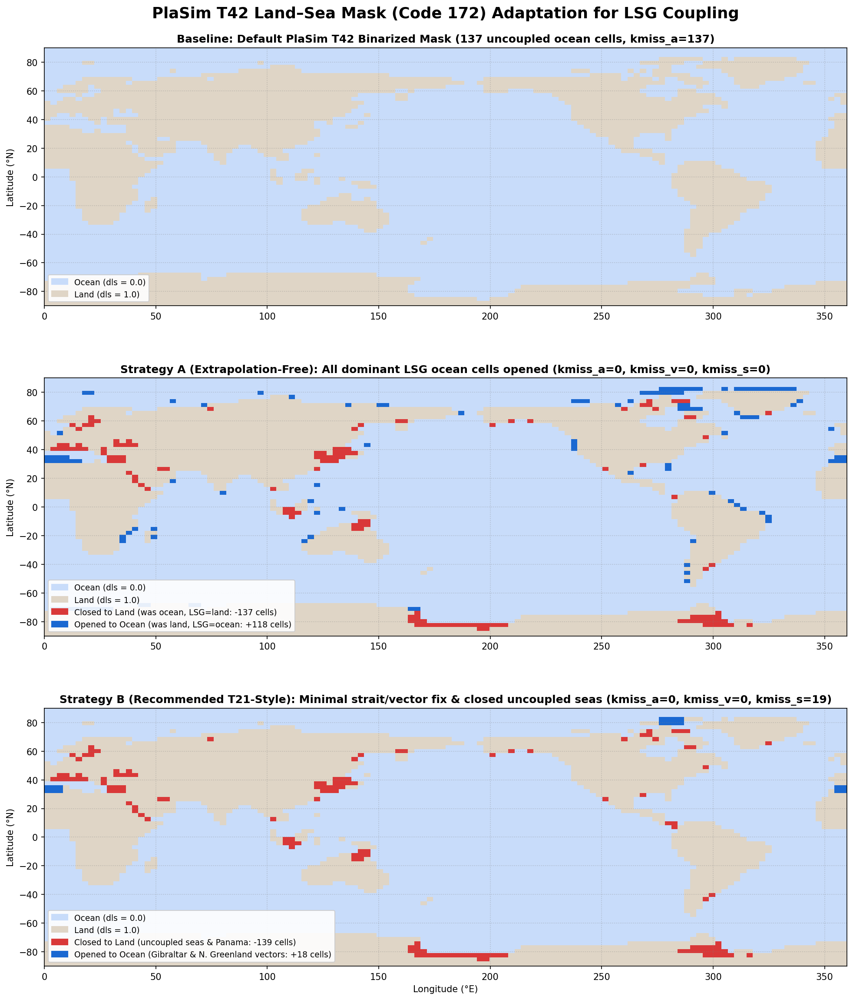
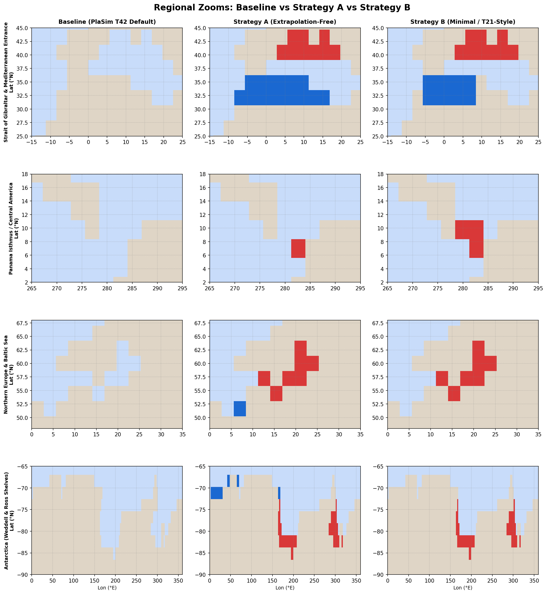

# Surface and boundary data

MoSt selects boundary data matching the compiled resolution and planet.
Keep the selected dataset with the experiment and record any changes;
copying unrelated files with the same extension is not a grid conversion.

## Current file names and format

Atmospheric surface boundary datasets are formatted Service ASCII (`.sra`)
files. The file name follows the pattern:

```
Nnnn_surf_cccc.sra
```

where `nnn` is the three-digit number of Gaussian latitudes (e.g., `032` for
T21 with 64 × 32 gridpoints, `048` for T31 with 96 × 48 points, and `064` for
T42 with 128 × 64 points) and `cccc` is the four-digit numeric field code.

Each `.sra` file contains formatted Service text. A record consists of an
eight-integer header followed by numeric data written in free format:

```fortran
integer :: ih(8)
real    :: field(nlon, nlat)

open(filenr, file='N032_surf_0129.sra', form='formatted')
read(filenr, *) ih
read(filenr, *) field
```

In the model's array layout, longitude varies fastest. Data must be provided
on the proper Gaussian latitudes, not an equally spaced latitude grid.

There are two temporal layouts:
- **Single annual-mean field (1 record):** Used for time-invariant boundary
  conditions such as topography, land–sea mask, or vegetation fractions.
- **Climatological annual cycle (14 monthly mean records):** Months 1 to 12
  represent January through December, with month 0 holding a duplicated December
  and month 13 holding a duplicated January. The model subroutine
  `get_surf_array` ({repo}`plasim/src/surfmod.f90`) accepts 14-month files
  directly, and will automatically perform cyclic padding if a 12-month file is
  supplied. Supplying a single annual field for a 14-month variable replicates
  the annual mean across all months.

The split files in `plasim/dat/` are copied by MoSt into `plasim/run/` during
model preparation. Older manuals suggested placing all fields into a single
monolithic file (`surface.sra` or `surface.txt`); while `surface_ini` still
contains a backward-compatibility reader that splits monolithic files on the fly,
new experiments should use the individual `Nnnn_surf_cccc.sra` files directly.

## Surface files: runtime usage and offline reference

A total of 15 boundary files are shipped with PlaSim for Earth in T21, T31,
and T42 resolutions under `plasim/dat/T21/`, `plasim/dat/T31/`, and
`plasim/dat/T42/`.

In the running model, however, code inspection of `surfmod`, `landmod`, `oceanmod`,
and `icemod` reveals an important operational distinction: **10 files are actively
read and used by the running model**, while **5 files are offline reference inputs**
retained from the original dataset synthesis.

### 1. Actively read Earth boundary files (10 files)

These 10 files are opened by `get_surf_array` via `mpsurfgp` and actively used
in standard Earth simulations:

| Code | Filename pattern | Abbr. | Variable description | Units | Records | Reading routine | Target array | Operational role in code |
| --- | --- | --- | --- | --- | --- | --- | --- | --- |
| `0129` | `Nnnn_surf_0129.sra` | `sg` | Surface geopotential ($g \cdot z_s$) | m²/s² | 1 | `surfini`, `landini` | `doro` | Transformed to spectral orography `soro` in `surfmod`; sets surface elevations in `landmod`. |
| `0169` | `Nnnn_surf_0169.sra` | `tsa` | Surface temperature / SST climatology | K | 14 (mm) | `oceanini`, `iceini`, `landini` | `yclsst`, `xclsst`, `dtcl` | Climatological SST boundary forcing/relaxation in `oceanmod` and `icemod`; soil surface climatology in `landmod`. |
| `0172` | `Nnnn_surf_0172.sra` | `lsm` | Land–sea mask | fraction [0, 1] | 1 | `surfini`, `landini`, `oceanini`, `iceini` | `dls`, `yls`, `xls` | Partition of land and water across all surface exchange, ocean, and ice routines. |
| `0173` | `Nnnn_surf_0173.sra` | `z0` | Total aerodynamic roughness length | m | 1 | `landini` | `dz0clim` | Climatological baseline aerodynamic surface roughness length $z_0$ in `landmod`. |
| `0174` | `Nnnn_surf_0174.sra` | `alb` | Background surface albedo | fraction [0, 1] | 14 (mm) | `landini` | `dalbcl` | Climatological monthly background surface albedo cycle in `landmod`. |
| `0210` | `Nnnn_surf_0210.sra` | `sic` | Sea ice concentration climatology | fraction [0, 1] | 14 (mm) | `iceini` | `xclicec` | Prescribed climatological sea ice fractional cover in `icemod`. |
| `0212` | `Nnnn_surf_0212.sra` | `vegf`| Forest ratio | fraction [0, 1] | 1 | `landini` | `dforest` | Forest area fraction used for canopy shading, snow-masking albedo, and roughness blending. |
| `0229` | `Nnnn_surf_0229.sra` | `mrfc`| Maximum soil field capacity ($w_{\max}$) | m | 1 | `landini` | `dwmax` | Soil bucket water storage capacity in `landmod` (converted to metres; lower-bounded at 0.001 m). |
| `0232` | `Nnnn_surf_0232.sra` | `glac`| Glacier fraction | fraction [0, 1] | 1 | `landini` | `dglac` | Permanent ice sheet / glacier area fraction in `landmod`. |
| `1730` | `Nnnn_surf_1730.sra` | `z0t` | Roughness length from topography | m | 1 | `landini` | `dz0climo` | Orographic component of roughness length; combined with SIMBA dynamic vegetation roughness in `simba.f90`. |

When `get_surf_array` successfully loads an active file, it records the action in
the model's diagnostic log (`plasim_diag`):

```text
 * Read doro          <N032_surf_0129.sra> *
 * Read dls           <N032_surf_0172.sra> *
 * Read dz0clim       <N032_surf_0173.sra> *
 * Read dz0climo      <N032_surf_1730.sra> *
 * Read dglac         <N032_surf_0232.sra> *
 * Read dforest       <N032_surf_0212.sra> *
 * Read dwmax         <N032_surf_0229.sra> *
 * Read dtcl          <N032_surf_0169.sra> *
 * Read dalbcl        <N032_surf_0174.sra> *
```

### 2. Shipped reference and offline files (5 files)

The remaining 5 files in `plasim/dat/` are part of the historical ECHAM/USGS/MODIS
dataset package, but are **not read by the running PlaSim model**:

| Code | Filename pattern | Abbr. | Variable description | Units | Status in code | Reason why not read by model executable |
| --- | --- | --- | --- | --- | --- | --- |
| `0199` | `Nnnn_surf_0199.sra` | `vegc`| Fractional vegetation cover | fraction [0, 1] | Not registered | Not registered in `surfmod.f90:surface_ini`; SIMBA dynamic vegetation predicts vegetation cover at runtime. |
| `0200` | `Nnnn_surf_0200.sra` | `lai` | Leaf area index (LAI) | m²/m² | Diagnostic only | Registered as `dlai` in `surfmod`, but never called by `mpsurfgp`. SIMBA dynamically computes `dlai` from biomass and outputs code 200 as diagnostic output. |
| `1731` | `Nnnn_surf_1731.sra` | `z0v` | Vegetation roughness length | m | Offline input | Not called in Fortran. Used offline to compute total roughness $z_0 = \sqrt{z_{0t}^2 + z_{0v}^2}$ (code 173). The model reads `0173` directly. |
| `1740` | `Nnnn_surf_1740.sra` | `albs`| Bare soil albedo ($a_s$) | fraction [0, 1] | Offline input | Registered as `dalbcls` in `surfmod`, but `landmod` reads the pre-combined seasonal albedo `0174` (`dalbcl`). |
| `1741` | `Nnnn_surf_1741.sra` | `albv`| Vegetation albedo ($a_v$) | fraction [0, 1] | Offline input | Registered as `dalbclv` in `surfmod`, but `landmod` reads the pre-combined seasonal albedo `0174` (`dalbcl`). |

These files are retained in `plasim/dat/` to preserve data provenance and allow
users to reconstruct custom roughness or albedo fields using the original offline
equations.

### 3. Optional and conditional boundary files

`surfmod.f90` also registers numeric codes for optional or diagnostic fields.
The model calls `mpsurfgp` for these files only when the corresponding module
or namelist option is activated:

| Code | Filename pattern | Variable description | Units | Records | Receiving module | Trigger condition in namelists / model |
| --- | --- | --- | --- | --- | --- | --- |
| `0022` | `Nnnn_surf_0022.sra` | Relaxation/nudging factor | dimensionless | 14 (mm) | `miscmod` | Read when nudging is enabled (`tnudget > 0` in `miscmod_nl`). |
| `0130` | `Nnnn_surf_0130.sra` | Nudging temperature climatology | K | 14 (mm) | `miscmod` | Read when nudging is enabled (`tnudget > 0` in `miscmod_nl`). |
| `0140` | `Nnnn_surf_0140.sra` | Soil wetness climatology | m | 14 (mm) | `landmod` | Read by `landmod` if present; if absent, defaults to $w_{\max} \cdot \text{drhsfull} \cdot \text{drhsland}$. |
| `0209` | `Nnnn_surf_0209.sra` | Deep soil temperature climatology | K | 1 | `landmod` | Read by `landmod` if present; if absent, initialized internally. |
| `0211` | `Nnnn_surf_0211.sra` | Sea ice thickness climatology | m | 14 (mm) | `icemod` | Read by `icemod` if present; if absent, initialized from sea ice cover $\times$ `hicefix`. |
| `0237` | `Nnnn_surf_0237.sra` | Climatological 3D ozone concentration | kg/kg | NLEV × 14 (mm) | `radmod` | Read by `radmod` when `no3=2` (climatological 3D ozone mode). |
| `0304` | `Nnnn_surf_0304.sra` | Initial carbon in vegetation biomass | kg C/m² | 1 | `simba` | Cold-start vegetation biomass initialization. |
| `0305` | `Nnnn_surf_0305.sra` | Initial carbon in soil | kg C/m² | 1 | `simba` | Cold-start soil carbon pool initialization. |
| `0709` | `Nnnn_surf_0709.sra` | Prescribed ocean-to-ice heat flux correction | W/m² | 14 (mm) | `icemod` | Read when ice flux correction is active (`nflxfix=1` in `icemod_nl`). |
| `0903` | `Nnnn_surf_0903.sra` | Prescribed SST heat flux correction | W/m² | 14 (mm) | `oceanmod` | Read when SST flux correction is active (`nflxfix=1` in `oceanmod_nl`). |
| `1604` | `Nnnn_surf_1604.sra` | Initial biomass growth rate | 1/s | 1 | `simba` | Read on cold start if present; overrides `forgrow` in `vegmod_nl`. |
| `1605` | `Nnnn_surf_1605.sra` | Above-ground growth fraction | fraction [0, 1] | 1 | `simba` | Read on cold start if present; overrides `rinidagg` in `vegmod_nl`. |
| `1606` | `Nnnn_surf_1606.sra` | Stomatal conductance multiplier | m/s | 1 | `simba` | Read on cold start if present; overrides `rinidsc` in `vegmod_nl`. |
| `1607` | `Nnnn_surf_1607.sra` | Maximum structural vegetation roughness | m | 1 | `simba` | Read on cold start if present; overrides `rinidmr` in `vegmod_nl`. |

If an optional file is not present in the working directory, `get_surf_array`
reports internal initialization in `plasim_diag`:

```text
 * Init dtnudge    [code = 130] internally *
 * Init dfnudge    [code =  22] internally *
 * Init dwcl       [code = 140] internally *
```

## Data sources and provenance

As documented in Chapter 8 of the PlaSim Reference Manual, the standard Earth
surface data were derived from four primary sources:

### 1. USGS 1 km Land Surface Parameter (LSP) dataset
*Codes: 174, 199, 200, 212, 229, 232, 1731*

These fields originate from the U.S. Geological Survey Land Surface Parameter
(LSP) dataset, which classifies global land cover into major ecosystem types at
1 km resolution. The dataset was prepared for ECHAM4/5 and PlaSim by Stefan
Hagemann (MPI for Meteorology, Hamburg) for T21, T31, and T42 resolutions:
- Values refer specifically to the land portion of each grid cell.
- Detailed descriptions of the derivations are published in MPI Scientific
  Reports:
  - Hagemann, Botzet, Dümenil, and Machenhauer (1999), *Derivation of global GCM
    boundary layer conditions from 1 km land use satellite data*, MPI Report 289.
  - Hagemann (2002), *An improved land surface parameter dataset for global and
    regional climate models*, MPI Report 336.

### 2. USGS GTOPO30 digital elevation model
*Codes: 129, 172, 173, 1730*

The surface geopotential orography ($g \cdot z_s$, code 129) and land–sea
mask (code 172) were derived from the USGS GTOPO30 global digital elevation model,
which has a 30-arc-second (~1 km) horizontal spacing.
- The high-resolution elevation was interpolated to the PlaSim Gaussian grids
  using area-preserving interpolation (calculated by Uwe Schulzweida, MPI Hamburg).
- Orographic roughness length $z_{0t}$ (code 1730) was calculated from subgrid
  elevation variance following Tibaldi and Geleyn (1981), *The production of a new
  orography, land-sea mask and associated climatological surface fields for
  operational purposes*, ECMWF Tech. Memo. 40.
- Total aerodynamic roughness length $z_0$ (code 173) combines orographic
  roughness $z_{0t}$ (code 1730) and vegetation roughness $z_{0v}$ (code 1731)
  in quadrature: $z_0 = \sqrt{z_{0t}^2 + z_{0v}^2}$.

### 3. MODIS satellite albedo products (2001–2004)
*Codes: 1740, 1741, 174*

Global surface albedos were provided by Diana Rechid (MPI for Meteorology,
Hamburg) at 0.5° resolution, based on Moderate Resolution Imaging
Spectroradiometer (MODIS) satellite observations from 2001 to 2004:
- The bare soil albedo ($a_s$, code 1740) and vegetation albedo ($a_v$, code 1741)
  are time-invariant annual fields for the land portion of the grid cell.
- The background surface albedo annual cycle ($a$, code 174) is synthesized
  from bare soil albedo $a_s$, vegetation albedo $a_v$, and seasonal leaf area
  index LAI (code 200) to represent vegetation phenology:
  - Rechid, Hagemann, and Jacob (2008), *Sensitivity of climate models to seasonal
    variability of snow-free land surface albedo*, Theor. Appl. Climatol.,
    doi:10.1007/s00704-007-0371-8.
  - Rechid, Raddatz, and Jacob (2009), *Parameterization of snow-free land surface
    albedo as a function of vegetation phenology based on MODIS data and applied
    in climate modelling*, Theor. Appl. Climatol., 95, 245–255.

### 4. AMIP-II boundary conditions (1870–2006)
*Codes: 169, 210*

Sea surface temperature (code 169) and sea ice concentration (code 210) were
compiled from the Atmospheric Model Intercomparison Project II (AMIP-II)
dataset (Karl Taylor, PCMDI) as multi-year climatological monthly means over the
period 1870–2006:
- The AMIP-II SST field is globally defined (extrapolated over land areas). This
  ensures that modifications to the model's land–sea mask or coastal boundaries
  do not result in undefined or uninitialized SST values.

## Dataset preparation and land-to-sea extension

Land surface parameters (such as soil capacity, vegetation, and albedo) are
physically defined only over land. However, because experiments might modify
the model's land–sea mask (`dls`), coastal land points could coincide with sea
points in the raw dataset if not handled properly.

To prevent missing data when modifying land–sea masks, the dataset generation
process applied an iterative flood-fill extension from land points onto adjacent
sea points:
1. Gridpoints with value < 0.0001 and LSM ≤ 0.005 were treated as unassigned sea points.
2. Unassigned points were replaced by the average of their valid neighboring
   points (value ≥ 0.0001 or LSM > 0.005).
3. The process iterated until all coastal borders were smoothly filled.

> [!IMPORTANT]
> Because land fields are extended into adjacent sea points in the `.sra` files,
> the model at runtime applies its active land–sea mask (`dls`) to mask out values
> over open water.

Additional bounds applied during boundary file preparation include:
- **Roughness lengths:** $z_0$ (code 173) and $z_{0t}$ (code 1730) are bounded
  below by a minimum of 0.0001 m.
- **Soil field capacity:** Maximum soil moisture holding capacity $w_{\max}$
  (code 229) was converted from mm to metres, with a minimum threshold of
  0.001 m (1 mm).
- **Change thresholds:** The threshold for changeable points was set to 0.5
  instead of 0.005 for $z_0$ (code 173) and albedo (codes 174, 1740, 1741),
  as well as for vegetation cover (199) and LAI (200) in T31 datasets.

## Land mask and orography in model execution

The atmospheric `surface_ini`/`surfini` path ({repo}`plasim/src/surfmod.f90`)
reads and prepares the surface fields during initialization:
- **Surface geopotential:** Input orography is geopotential $\Phi_s = g \cdot z_s$
  in m²/s². To create custom orography from an elevation in
  metres, multiply by the configured planetary gravity $g$ (e.g. 9.80665 m/s²
  for Earth). In spectral space, `surfini` truncates orography at `noromax`
  (defaulting to `NTRU`).
- **Land–sea mask:** Fractional land–sea mask values in `Nnnn_surf_0172.sra` are
  clipped to [0, 1]. Values are not hard-thresholded at 0.5; land and sea
  surface fluxes weight processes by the fractional land area.
- **Coupled LSG mask:** When running coupled to the LSG ocean model, always
  preserve the matching coupled land–sea mask (`lsg/dat/Nnnn_surf_0172.sra`),
  because ocean matrix geometry and atmospheric land masks must
  align along coastlines. See [](lsg-surface-masks) below.

(lsg-surface-masks)=
## Coupled LSG land–sea mask adaptation (code 172)

When running PlaSim coupled to the 3D LSG deep-ocean model, atmospheric surface
fluxes (heat, freshwater, and momentum) are exchanged across two disparate grid
systems:
1. The **atmospheric Gaussian grid** (`nlon` × `nlat`, e.g., 64 × 32 at T21, 96 × 48 at T31, 128 × 64 at T42), where surface points are partitioned into land and ocean by the land–sea mask (`dls`, code `0172`).
2. The **LSG ocean Arakawa E-grid** (72 × 72 interior, 72 × 76 total), defined by bathymetry depths in `lsg/dat/topogr`. On the E-grid, ocean scalar points (`zslmoa`, where depth $H > 0$) carry tracer properties (temperature, salinity), while ocean velocity vector points (`oslmv = 1`) carry horizontal currents on a shifted subgrid.

### Grid mismatch and uncoupled cells (Issue #20)

During initialization in `cpl.f90` (`cplini`), the coupler computes area-overlap weights (`zomao` and `zomaov`) between atmospheric grid cells and ocean cells. The coupler tracks two diagnostic counters:
- **`kmiss_a` (Uncoupled atmospheric ocean points):** Atmospheric ocean cells ($dls < 0.5$) that have zero ocean depth underneath ($H = 0$) on the LSG grid. Because no ocean column exists to receive atmospheric fluxes at these locations, heat and freshwater exchanges cannot be balanced, violating physical coupling consistency.
- **`kmiss_v` (Starved ocean velocity vectors):** LSG velocity vector points (`oslmv = 1`) that do not overlap any active atmospheric ocean cells in their four-point interpolation stencil (`zomaov`). If `kmiss_v > 0`, the wind stress on that ocean velocity point is uncoupled and set to zero.

Historically, `lsg/dat` provided a hand-tuned land–sea mask only for T21 resolution (`N032_surf_0172.sra`). When running coupled simulations at higher resolutions (T31 or T42), MoSt copied only the T21 mask from `lsg/dat`, leaving the atmospheric model to read the standard uncoupled masks from `plasim/dat/T31/` or `plasim/dat/T42/`. This led to significant grid mismatches:
- **T31 default mask:** 58 uncoupled atmospheric ocean cells (`kmiss_a = 58`), 2 starved vector cells (`kmiss_v = 2`).
- **T42 default mask:** 137 uncoupled atmospheric ocean cells (`kmiss_a = 137`), 2 starved vector cells (`kmiss_v = 2`).

### Automated mask derivation (Strategy B)

To guarantee topological consistency between the atmosphere and the fixed LSG bathymetry across all resolutions without modifying the underlying ocean model or matrices, the script `scripts/derive_lsg_sra.py` implements an automated derivation algorithm (**Strategy B**):

1. **Eliminate uncoupled atmospheric cells:** Any atmospheric grid cell with zero underlying LSG ocean depth (`zslmoa < 1e-9`) is converted to land (`dls = 1.0`). This guarantees `kmiss_a = 0`.
2. **Preserve continental barriers:** The narrow Isthmus of Panama ($7^\circ\text{--}11^\circ\text{ N}, 276^\circ\text{--}283^\circ\text{ E}$), which is open water in raw uncoupled Gaussian interpolations, is closed to land to prevent unphysical Pacific–Atlantic atmospheric exchange.
3. **Targeted vector opening:** For each starved LSG ocean vector point (`oslmv = 1` where `kmiss_v > 0`), the algorithm locates the overlapping atmospheric cell that contains the highest LSG ocean coverage and opens it to ocean (`dls = 0.0`). This opens narrow key passages—specifically the Strait of Gibraltar and the passage north of Greenland—without over-eroding continental boundaries.
4. **Preserve coastal scalar extrapolation:** The coupler's standard coastal flood-fill (`cfill`) safely extrapolates atmospheric fluxes to any isolated coastal ocean scalar cells (`kmiss_s = 19` at T31 and T42, compared to 42 in standard T21).

The resulting land–sea masks achieve `kmiss_a = 0` and `kmiss_v = 0` across T21, T31, and T42:

| Resolution | Grid points | Atmospheric uncoupled (`kmiss_a`) | Starved vectors (`kmiss_v`) | Extrapolated scalars (`kmiss_s`) | Shipped dataset file |
| --- | --- | --- | --- | --- | --- |
| **T21** | 64 × 32 | 0 | 0 | 42 | `lsg/dat/N032_surf_0172.sra` |
| **T31** | 96 × 48 | 0 | 0 | 19 | `lsg/dat/N048_surf_0172.sra` |
| **T42** | 128 × 64 | 0 | 0 | 19 | `lsg/dat/N064_surf_0172.sra` |

### Visual comparison of T42 masks

The figures below show the difference between the default uncoupled PlaSim T42 land–sea mask and the LSG-adapted Strategy B mask:



*Figure 1: Global distribution of the default uncoupled PlaSim T42 land–sea mask (left), the LSG-adapted Strategy B mask (center), and their point-by-point difference (right). Red cells represent areas closed to land to prevent uncoupled atmospheric ocean cells (`kmiss_a = 0`); blue cells represent narrow passages opened to ocean to support LSG vector stencils (`kmiss_v = 0`).*



*Figure 2: Regional zooms highlighting critical passages: (a) Strait of Gibraltar opened for ocean exchange; (b) Denmark Strait aligned with ocean topography; (c) Isthmus of Panama preserved as a land barrier; (d) Northern Greenland channel opened to eliminate starved ocean vectors.*

### Offline derivation with `derive_lsg_sra.py`

Pre-derived masks for T21, T31, and T42 are provided in `lsg/dat/` and automatically copied by MoSt into the run directory when `LSG Ocean` is enabled.

To regenerate or inspect masks offline using `scripts/derive_lsg_sra.py`:

```sh
python3 scripts/derive_lsg_sra.py \
    -i plasim/dat/T42/N064_surf_0172.sra \
    -t lsg/dat/topogr \
    -o lsg/dat/N064_surf_0172.sra \
    -s B
```

The script runs with pure Python 3 standard library modules, verifies the overlap geometry against the LSG bathymetry, and prints coupling diagnostic statistics.

## Prepare, convert, and inspect data

The repository supplies conversion helpers under `scripts/`:

| Helper script | Purpose |
| --- | --- |
| `sra2nc` | Converts a formatted `.sra` text file to NetCDF (`sra2nc input.sra output.nc`). |
| `nc2sra` | Converts a 2D NetCDF variable to a formatted `.sra` file (`nc2sra input.nc output.sra code [-d YYYYMMDD] [-t HHMM]`). |
| `derive_lsg_sra.py` | Derives LSG-consistent atmospheric land–sea masks matching LSG ocean bathymetry and vector points across resolutions (T21, T31, T42). |
| `makesra` | Compiles Fortran conversion utilities for Service format datasets. |
| `earth.sh` | Extracts and prepares Earth boundary datasets for selected resolutions. |
| `aqua.sh` | Generates aquaplanet boundary datasets (all-ocean orography and zero land fraction). |

To inspect a checked-in boundary dataset using CDO:

```sh
bash scripts/sra2nc plasim/dat/T21/N032_surf_0172.sra mask.nc
cdo -s griddes mask.nc
cdo -s infon mask.nc
```

When creating new boundary files with `nc2sra`:
- Ensure the input NetCDF file uses the exact Gaussian grid matching the target
  model resolution.
- Verify that the numeric Service code matches the intended variable (e.g.,
  `129` for orography, `172` for land–sea mask).
- Check the output header and array dimensions before placing the new `.sra` file
  into `plasim/dat/` or your experiment directory.

## Sources checked

- PlaSim Reference Manual, Chapter 8 (*Surface Data*, pp. 71–78) and
  Bibliography (pp. 81–85).
- Model routines: `surface_ini`, `surfini`, `code_surf_file`, `get_surf_array` in
  {repo}`plasim/src/surfmod.f90`.
- Calling modules: `landini` ({repo}`plasim/src/landmod.f90`), `oceanini`
  ({repo}`plasim/src/oceanmod.f90`), `iceini` ({repo}`plasim/src/icemod.f90`),
  `simbaini` ({repo}`plasim/src/simba.f90`), `radini` ({repo}`plasim/src/radmod.f90`),
  `miscini` ({repo}`plasim/src/miscmod.f90`), `mpsurfgp` in {repo}`plasim/src/mpimod.f90`,
  and `cplini` in {repo}`cpl.f90`.
- Scripts: {repo}`scripts/derive_lsg_sra.py`, {repo}`scripts/sra2nc`, {repo}`scripts/nc2sra`, and {repo}`scripts/makesra`.
